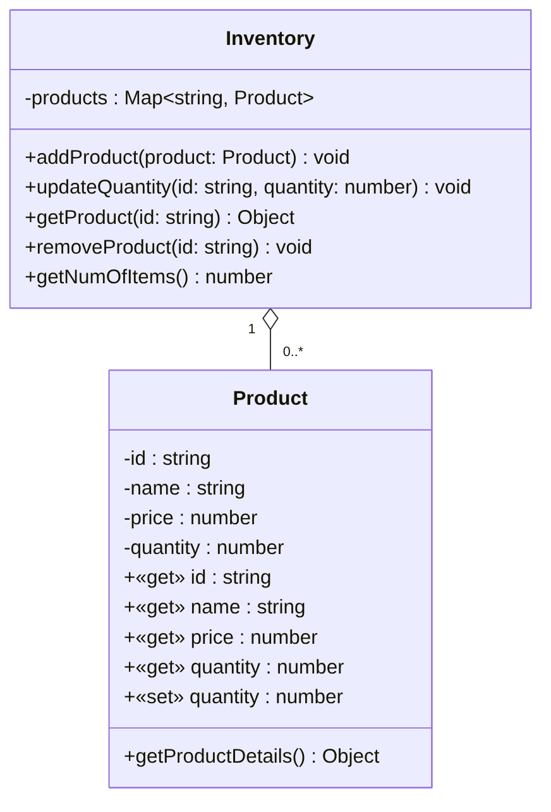
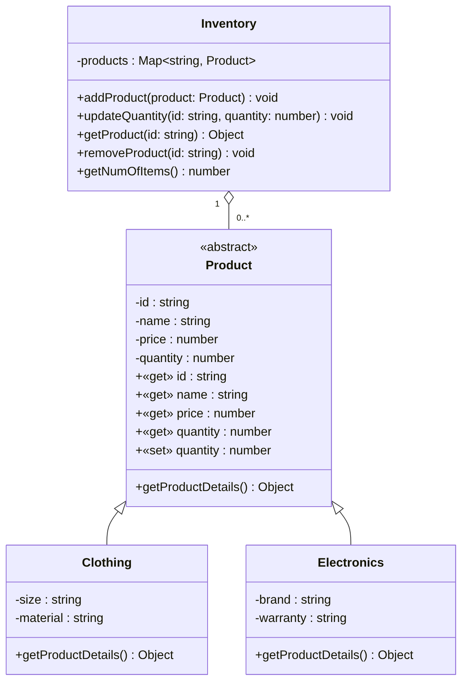

# Primer Challenge 4: OOP Stock Control System

## Learning Outcomes:

* Apply object-oriented programming principles (inheritance, polymorphism) in a practical scenario.
* Extend existing code to accommodate new requirements.
* Write robust and maintainable code with proper error handling.

Extend the provided inventory management program to support different product types with unique attributes.

*   **Clothing:** With attributes like `size` and `material`.
*   **Electronics:** With attributes like `brand` and `warranty`.

### Base Code:

The base code includes the following classes and methods:

*   **Inventory Class:**
    *   `addProduct(product)`
    *   `updateQuantity(id, quantity)`
    *   `getProduct(id)`
    *   `removeProduct(id)`
    *   `getNumOfItems()`

*   **Product Class:**
    *   `getProductDetails()`

`primer4.test.js` includes the current tests written for this code, and it currently passes them all.

### UML Class Diagram (Base Code)



Members marked `«get»` and `«set»` are JavaScript getters and setters, so you use them like properties: `product.id` and `product.quantity = 50`, not `product.getId()`. The private fields (`-id` and so on) are JavaScript private fields such as `#id`. The `.mmd` files in `images` are the Mermaid source for both diagrams.


**Tasks:**

1.  **Create Subclasses:**
    *   Create subclasses for `Clothing` and `Electronics` that inherit from the `Product` class.
    *   Add the specific attributes to each subclass.

2.  **Implement Polymorphic Functions:**

    *   Ensure that the `getProductDetails()` method is overridden in the subclasses to include the unique attributes.

**Example Usage:**

```javascript
const inventory = new Inventory();

const tshirt = new Clothing('A123', 'T-shirt', 19.99, 100, 'L', 'Cotton');
const laptop = new Electronics('B456', 'Laptop', 799.99, 20, 'Dell', '1 year');

inventory.addProduct(tshirt);
inventory.addProduct(laptop);

const retrievedProduct = inventory.getProduct('B456');
console.log(retrievedProduct); // Should output the laptop details including brand and warranty
```

### UML Class Diagram (Extended version)




### Additional Considerations:

1. Error Handling: Ensure that your methods handle errors gracefully (e.g., invalid quantities, incorrect datatypes etc.).
2. Code Quality: Adhere to the provided programming standards for clear, maintainable code. 
3. Testing: Add additional tests (in appropriate nested `describe` blocks) to `primer4.test.js` to verify the functionality of your extended inventory management system.
4. Make `Product.js` an abstract Class so that Product objects cannot be instantiated. You can modify `primer4.test.js` as you require.
5. Implement the Factory design pattern, and add your own testing code in `primer4.js`. You can modify `primer4.test.js` as you require.
6. Implement the Strategy design pattern for pricing. Each product uses a pricing strategy (for example full price, a percentage discount or a clearance price) to work out its selling price, and a product's strategy can be changed while the program runs without editing the product classes. Add tests for your strategies.
7. The UML class diagrams above do not show the Factory or Strategy patterns. In your `PORTFOLIO.md`, explain how each pattern fits into the design and why it helps.

### Notes

* Run only this primer's tests with `npm test -- primer4`.
* Commit and push as you go.
* Your code is marked against the Primer 4 rubric in the main [README](../README.md).
